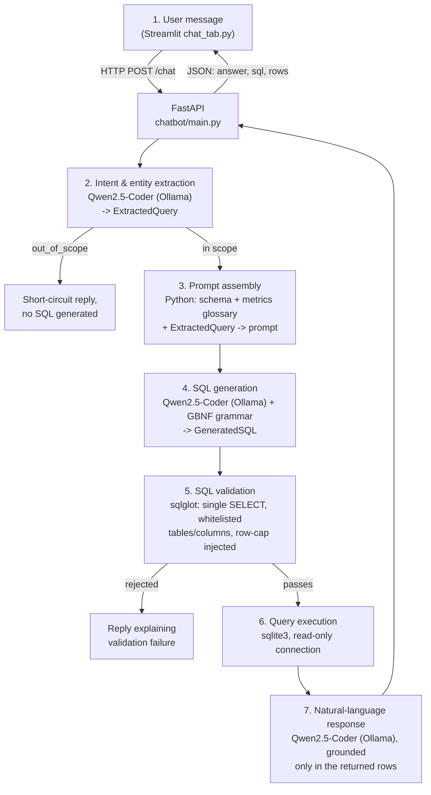

# Dashboard Chatbot -- local, fast-mode pipeline

A chat tab bolted onto the Streamlit dashboard that answers plain-language
questions about the same data, running entirely on-machine: Qwen2.5-Coder 3B via
Ollama by default, no external model API calls.

## Architecture



| # | Stage | Implementation | File |
|---|---|---|---|
| 1 | User message | FastAPI endpoint | `main.py` |
| 2 | Intent & entity extraction | Qwen2.5-Coder (Ollama), grammar-constrained JSON | `intent_schema.py`, `llm.py` |
| 3 | Prompt assembly | Plain Python: schema description + metrics glossary + the structured request | `schema_glossary.py`, `pipeline.py` |
| 4 | SQL generation | Qwen2.5-Coder (Ollama), grammar-constrained JSON wrapping the SQL | `sql_schema.py`, `llm.py`, `sql_grammar.gbnf` |
| 5 | SQL validation | `sqlglot` AST check: single SELECT, whitelisted tables/columns, row cap | `sql_validator.py` |
| 6 | Query execution | `sqlite3`, opened `mode=ro` + `PRAGMA query_only` | `db.py` |
| 7 | Natural-language response | Qwen2.5-Coder (Ollama), grounded only in the rows from stage 6 | `pipeline.py`, `llm.py` |

`pipeline.py` is the only file that calls stages 2-7 in order; `main.py` is
the only file that knows about HTTP.

### Why "GBNF grammar" shows up in two places

Ollama's public API only accepts a JSON-schema `format` for constrained
decoding -- it compiles that schema into a GBNF grammar internally (true
since Ollama v0.5's "structured outputs"), so stage 4 gets real
grammar-constrained decoding through `llm.py`'s `format=GeneratedSQL.model_json_schema()`
call, without needing to hand it a grammar file directly.

`sql_grammar.gbnf` is a **stricter, hand-written** SQL-only grammar for
anyone running a raw `llama-server` (llama.cpp) instead of/alongside Ollama --
that server *does* accept an arbitrary `--grammar-file`. **Nothing in this
project reads it** (confirmed by a full-codebase search), and it only covers
plain SELECT/JOIN/WHERE/GROUP BY -- not subqueries, CTEs or window functions,
which the validator now accepts. If you don't run llama.cpp directly, you can
safely delete it.

### Defense in depth

A generated query has to pass three independent checks before its result
reaches the user:

1. **Grammar-constrained decoding** (stage 4) -- the model can't emit a
   token outside the schema.
2. **AST validation** (stage 5) -- `sqlglot` parses the SQL and checks every
   table/column against a hand-maintained whitelist, rejects anything but a
   single `SELECT`, and caps `LIMIT`.
3. **Read-only connection** (stage 6) -- opened with `mode=ro` and
   `PRAGMA query_only = TRUE`, so even a write statement that somehow got
   past 1 and 2 would fail here instead of running.

## Setup

```bash
# 1. Install Ollama, then pull the model once:
ollama pull qwen2.5-coder:3b

# 2. (Ryzen 7 8845HS / Radeon 780M) start Ollama on the GPU -- see "Using the GPU" below.
#    Windows:  powershell -ExecutionPolicy Bypass -File chatbot\run_ollama_gpu.ps1

# 3. From the project root (the folder containing both chatbot/ and dashboard/):
pip install -r chatbot/requirements.txt
python -m chatbot.check_model --pipeline     # checks Qwen, speed and GPU use
uvicorn chatbot.main:app --port 8000

# 4. In a second terminal:
cd dashboard
pip install -r requirements.txt
streamlit run app.py
```

Open the dashboard, click the **Chatbot** tab in the sidebar, and ask
something like *"What's our AOV in Germany this year?"* or *"Which payment
method brings in the most revenue?"*.

### Langfuse (optional)

The launcher reads only `chatbot/langfuse.env`. Copy `chatbot/langfuse.env.example`
to `chatbot/langfuse.env`, paste freshly generated project keys without quotes,
and keep the file private. The example is blank on purpose; credentials are never
included in this ZIP. If the file or either key is missing, tracing stays off.
For the US cloud, use `https://us.cloud.langfuse.com` as `LANGFUSE_BASE_URL`.

### Reading response-time logs

The `generated=1 tok` line is the startup warm-up, not a user's answer. For each
chat, use the following `ollama:` line: `prompt_read` is input processing,
`generated` is model output, `load` is a cold model load, and `other` is client
and HTTP overhead. A 100% GPU share confirms placement, but output tokens per
second and SQL/database time determine the actual answer delay. The `/chat`
request log reports total elapsed time; `timings ms` splits pipeline stages.

### Using the GPU (Ryzen 7 8845HS + Radeon 780M)

The 780M (gfx1103) is not on Ollama's ROCm support list, so Ollama must use its
**Vulkan** backend. Ollama only enables it when `OLLAMA_VULKAN=1`. Your log's
`Model warmed up: 100% on GPU` confirms the current process placed the model on the GPU.

- **Windows:** run `chatbot\run_ollama_gpu.ps1` (sets the variables for your user and
  starts `ollama serve`). Keep your AMD Adrenalin driver current.
- **Linux (systemd):** `sudo systemctl edit ollama`, add under `[Service]`:
  `Environment="OLLAMA_VULKAN=1"`, `Environment="OLLAMA_IGPU_ENABLE=1"`,
  `Environment="OLLAMA_NUM_PARALLEL=1"`, then `sudo systemctl restart ollama`.
  You need Mesa's Vulkan driver (`sudo apt install mesa-vulkan-drivers vulkan-tools`).
- **Verify:** `python -m chatbot.check_model` prints the GPU share, or run `ollama ps`
  (the PROCESSOR column should say `100% GPU`). The server log also prints it at start-up.
- **Only partly on GPU?** Try `CHATBOT_LLM_NUM_GPU=999`, or
  `CHATBOT_LLM_NUM_CTX=4096`.
- **Known issue:** Ollama 0.32.10+ has reported Vulkan crashes on the 780M with *large*
  models (18 GB+); 7B/3B models are fine. If you see `ErrorDeviceLost`, use an earlier
  Ollama version or set `OLLAMA_VULKAN=0` to fall back to CPU.

Speed notes: an iGPU shares system RAM, so token *generation* is limited by memory
bandwidth and is only modestly faster than the CPU. The big win is *prompt processing*
(the ~2k-token schema prompt), which the GPU speeds up a lot, and which the warm-up
plus a single parallel slot caches. Use `check_model` to see your real tokens/second.

### Config (environment variables, all optional)

| Variable | Default | Purpose |
|---|---|---|
| `OLLAMA_HOST` | `http://127.0.0.1:11434` | Where Ollama is listening |
| `CHATBOT_LLM_MODEL` | `qwen2.5-coder:3b` | Model tag to use for all LLM stages |
| `CHATBOT_LLM_NUM_CTX` | `6144` | Context window sent on every call (keep constant) |
| `CHATBOT_LLM_NUM_GPU` | *(auto)* | Layers on GPU; `999` forces all |
| `CHATBOT_LLM_NUM_THREAD` | *(auto)* | CPU threads for anything not on the GPU (try `8`) |
| `CHATBOT_LLM_NUM_PARALLEL` | `1` | Concurrent model calls |
| `CHATBOT_LLM_THINK` | `auto` | `auto`/`off`/`on` -- thinking is disabled for Qwen3-style models |
| `ECOMMERCE_DB_PATH` | `<project root>/sqlite_db/ecommerce.db` | Database the chatbot queries |
| `CHATBOT_MAX_ROWS` | `200` | Hard cap injected into every generated query |
| `CHATBOT_SQL_TIMEOUT_S` | `15` | Stop a database query that runs too long; set to `0` to disable |
| `CHATBOT_MEMORY_CONTEXT_CHARS` | `1200` | Max size of the conversation history put in each follow-up prompt. Smaller = faster follow-ups (history is re-read every time at ~65 tok/s); `800` = newest turn only |
| `CHATBOT_API_URL` (set on the Streamlit side) | `http://localhost:8000/chat` | Where `dashboard/chat_tab.py` sends questions |

## Known gaps / next steps

- **Validator checks are flat, not per-scope.** Every real table in the query
  (including inside subqueries) is checked against the whitelist, but column
  checks do not track which SELECT a column belongs to. A wrong column inside a
  derived table can slip past the validator; SQLite then reports it and the
  pipeline's one retry sends the error back to the model.
- **UNION / INTERSECT / EXCEPT are not accepted** (only a single SELECT, which
  may contain CTEs, derived tables and window functions).
- **SQL timeout:** read-only queries are interrupted after 15 seconds by default;
  increase `CHATBOT_SQL_TIMEOUT_S` if your real database needs longer for valid queries.
- **Memory is in-process** (one uvicorn worker, lost on restart) -- fine for one
  dashboard.
- Your project-level `tests/` folder (`test_units.py`, `run_golden.py`) was not in
  the zip; keep using it, and re-run it after applying this update.

## Latest changes (audit fixes)

Every item was checked against the real `ecommerce.db`, not just the code.

- **Follow-up speed:** `MEMORY_CONTEXT_CHARS` default 3500 -> 1200 (the comment
  above it already said "keep it small"). Worst-case history re-read drops from
  ~1,100 to ~400 tokens (~17 s -> ~6 s at 65 tok/s); three typical turns still fit.
- **Follow-up guard (`followup.py`):** a fresh chat's "what about email open rate",
  "also credit limit by tier", "and average age by country", "what about urban
  ratio" were refused with "I don't have an earlier question". The metric list now
  covers every measurable column. Deliberately NOT added: filter values and
  groupings (country, tier, device, shipping, campaign, a bare "email", a bare
  "credit") -- "what about credit card", "what about email" and "also by device"
  must still be recognised as dangling follow-ups.
- **Validator (`sql_validator.py`):** derived tables (`FROM (SELECT ...) AS sub`),
  inner aliases used by the outer query, and reused aliases are now accepted, so
  "above the average" and "top N per group" questions can run. Table whitelist,
  single-SELECT rule and row cap are unchanged.
- **Schema prompt (`schema_glossary.py`):**
  - `sessions.campaign_id` is no longer "loosely populated" (0 NULL, 0 orphans in
    2,000,000 sessions); `customers.region -> geo_data` documented too.
  - Region rule: `customers.region` (home region) for customer metrics and
    revenue/orders; `sessions.geo_ip_region` only for session metrics. They
    disagree in 99% of sessions.
  - Formulas, synonyms and NULL warnings for `email_open_rate`, `loyalty_score`,
    `avg_review_score`, `credit_limit`, `age`, `session_duration`, `pages_viewed`,
    `cart_additions`, `signup_date`, all `geo_data` and `marketing_campaigns`
    columns; a "which table / GROUP BY" guide.
  - `customers.discount_usage_rate` (avg 0.33) is a different number from the
    order-level discount rate (0.50): the order-level formula stays the default.
  - `email` as traffic channel vs. campaign type; campaign budget must not be
    summed after joining sessions; NULLs sort first in ASC (`IS NOT NULL` when
    ranking); `age`/`session_duration`/`pages_viewed` are REAL.
- **Prompt size:** +~3.9k chars (~1,200 tokens). It is read once at warm-up and then
  served from Ollama's prefix cache, so start-up warm-up is a little slower and
  per-question time is unchanged. Still ~2,200 tokens of headroom in the 6,144 window.
- **Two new few-shot examples** (top-N per group via a derived table; a campaign
  join) and percent formatting for `internet_penetration`.
- **Standard mode catalog (`intent_schema.py`):** metric / group-by lists include the
  new metrics and both region kinds.
- **New tests (no Ollama needed):** `python -m unittest chatbot.tests.test_audit_fixes -v`.
  Live check against ground-truth SQL: `python -m chatbot.tests.audit_questions`
  (`--dry` verifies only the ground truth).

## Latest changes (fast mode, accuracy fixes, tests)

- **Fast mode (default):** intent + SQL come from ONE model call; short results are formatted in Python (no model call). `CHATBOT_FAST_MODE=0` restores the original 7-stage flow.
- **`value_fix.py`:** puts text values into the database's exact spelling before validation (`'platinum'` -> `'Platinum'`, `'India'` -> `'IN'`).
- **Retry:** in fast mode, a query that fails validation/execution is sent back to the model once with the error (`CHATBOT_MAX_RETRIES`).
- **Validator is table-aware:** a column must exist in the table it is used with.
- **Few-shot examples + valid-values list** in the prompt (schema_glossary.py, pipeline.py).
- **Cache + warm-up + per-stage timing logs.**
- **Tests:** `python -m unittest tests.test_units -v` (no Ollama needed) and `python tests/run_golden.py` (45 hard questions, needs Ollama).


## Latest changes (Qwen switch, GPU, bug fixes)

- **Model:** default is now `qwen2.5-coder:3b` for faster local replies.
- **Removed the Outlines backend.** It was wrapped around a client with a 3-second probe
  timeout, so real generations timed out and fell back to Ollama's `format=` anyway --
  wasting up to 3 s per call. Now there is one clean path.
- **`num_ctx` is set explicitly** (6144). Before, Ollama's default could silently cut off
  the schema prompt.
- **Retry prompt keeps its context.** The corrective retry used to drop the reference date
  and the conversation history; now it reuses the full original prompt.
- **Honest errors.** "Ollama is down", "model not pulled", "timed out" and "model output
  unparsable" now give different messages (before, all showed "check that Ollama is running").
  A truncated JSON reply is retried once with a 50% bigger token budget.
- **Warm-up** is one 1-token call instead of up to 3 calls, and runs in the background so the
  API starts immediately; it logs the GPU share.
- **`/health`** reports model installed/loaded and GPU %. `/chat` uses one request ID
  (the header and body used to differ); `/chat/stream` now streams stages live instead
  of after the fact.
- **New:** `check_model.py` (model, speed, GPU check) and `run_ollama_gpu.ps1`.
- Removed dead code (`stream_text`, unused retry helper/constant).

## How a question is understood (synonyms + slot memory)

Before the model sees anything, plain Python (no model call, well under a millisecond):

1. **Synonym layer** (`synonyms.py`): fixes typos of schema words ("emal opning rate"), recognises
   the metric ("opens the emails" / "email engagement" -> `email_open_rate`), the grouping
   ("which country", "by device"), filters (germany, gold, mobile, paypal...), time and ranking,
   and adds a one-line hint where the schema is ambiguous ("email" is a column, a traffic source
   AND a campaign type; "region" is two different columns).
2. **Slot memory** (`slotmem.py`): the previous question is remembered as parts
   (`metric | by | filters | time`), not as text. Each new message is classified:
   - **fresh**: it names its own metric -> a NEW question; old filters are dropped, history not sent.
   - **slots**: a follow-up Python understood completely ("what about india", "only gold",
     "by device", "overall", "top 3") -> merged and rewritten as one clear question; history not sent;
     the model only writes SQL.
   - **legacy**: anything it is not sure about (pronouns "them/those", "above/than/between",
     unknown words) -> the old behaviour: history text + the model decides.
   The rewrite is shown to the user as "Understood as".

Add a column / valid value: update `schema_glossary.py`, `value_fix.py` AND the vocabulary in
`synonyms.py` (`tests/test_synonyms.py` fails if a valid value is not recognised).

## Langfuse tracing (optional)

Off unless the `langfuse` package is installed **and** fresh keys are set in `chatbot/langfuse.env`
(copy `chatbot/langfuse.env.example`; the launcher reads only `langfuse.env`). When off nothing changes. When on it adds no
latency (background export) and can never break an answer. Works with Langfuse Python SDK v3 and v4.

One trace per question, grouped by chat session (Sessions view):

    chat-request   input = question; output = answer, SQL, "understood as", sample rows
    |- sql-plan    (generation) messages, reply, tokens in/out, load / prompt-read / generate s, tok/s
    |- validate    (span) SQL after canonicalising; red if rejected
    |- execute     (span) row count
    `- ...a second sql-plan/validate/execute if the retry fired (attempt=2)

- Tags: `model:<name>`, `mode:fast` (compare model sizes by filtering on the tag).
- Root metadata: `path` (llm / fastpath / cache / followup-guard), `resolution` (fresh / slots / legacy)
  and its reason, `typo_fixes`, `hints`, `slots`, `timings_ms`, `attempts`, error text.
- Scores: `answered_from_data` (1/0), `path` (categorical), `user_feedback` (thumbs, 1/0).
- The ~9 KB system prompt is replaced by its length + hash (it is static code). Set
  `CHATBOT_LANGFUSE_FULL_PROMPT=1` to send it in full.
- Privacy: question, SQL and the first `CHATBOT_LANGFUSE_ROWS` rows (default 5; 0 = none) go to the
  Langfuse host. Self-host Langfuse to keep everything on this machine.

## Feedback loop (works with or without Langfuse)

1. Every answer returns an `answer_id`; the dashboard shows thumbs up/down under it (a thumbs-down
   offers a "what went wrong?" note).
2. `POST /feedback {answer_id, helpful, comment?}` appends a line to `chatbot/feedback_log.jsonl`
   (question, how it was understood, SQL, path, model, note) and, with Langfuse on, scores the trace.
3. `python -m chatbot.feedback_review` lists the thumbs-down answers; `--write-tests` drafts cases in
   `tests/feedback_cases.jsonl`. Fill in `expected_sql`, copy the case into `CASES` in
   `tests/audit_questions.py`, fix the glossary / synonyms, and re-run
   `python -m chatbot.tests.audit_questions` to prove it is fixed and stays fixed.

Tests (no Ollama or network needed): `python -m unittest discover -s chatbot/tests -t . -v`

## Performance and accuracy fixes from the October 4 run

The supplied Qwen2.5-Coder 3B log shows a 16.0 s startup warm-up (including a 5.3 s cold load). That one-token warm-up is not a normal user question. After warm-up, the model stayed loaded on the GPU and used about 1.8-4.3 s to generate SQL; the 0.02-0.08 s `other` time shows HTTP setup is no longer the bottleneck. The slowest ordinary question was the legacy follow-up: it repeated an invalid `device_type` column on `customers`, retried the same mistake, and took 11.3 s total.

This build adds strict, model-free SQL templates for email open rate grouped by country, tier, or device and for AOV with supported filters/date ranges. “Same for them by device” is recognized for a customer metric and uses distinct customer/device pairs from `sessions`. Relative dates are resolved from the newest transaction date in the database; for this database, “this year” means 2024-01-01 through 2024-09-26 inclusive. The exact “customers whose total spend is above the overall average” question now compares each customer's sum with the average of customer sums, and exact fast paths run even in a chat with history.

These templates bypass SQL generation and its retries. Unsupported shapes continue through the model and validator. On the supplied database, the AOV template returned $119.43 for German orders in the resolved period, the device template executed successfully, and the above-average template returned 74,446 customers. The local no-Ollama suite passed 100 tests; 16 optional-dependency tests were skipped in the packaging environment. A real Ollama/Langfuse end-to-end run still depends on the user's machine and credentials.


## Semantic accuracy update (v1.6.0)

- The schema prompt now distinguishes declared database constraints from logical keys verified unique in the supplied snapshot. SQLite has no declared PK/FK constraints in this database; the data audit found 200,000 unique customer IDs, 500,000 unique transaction IDs, 2,000,000 unique session IDs, 200 unique campaign IDs, and 100 unique region keys, with no orphan transaction/session customer references or session campaign references.
- Explicit grain and join guidance prevents transaction/session fan-out, separates customer home region (`customers.region`) from session location (`sessions.geo_ip_region`), and defines customer-weighted geo metrics.
- Every table alias must be used consistently for column references. For example, `FROM customers AS c` requires `c.email_open_rate`, never `customers.email_open_rate`.
- The supplied home-region comparison (internet penetration vs. customer email open rate by tier) now has a narrow deterministic SQL template. It avoids an LLM alias mistake and keeps `gap_pp` in percentage points in the displayed response.
- Rate units, average-of-customer-totals semantics, and campaign-budget fan-out warnings are explicit in the metric catalog.

## Langfuse run fixes (v1.7.0)

The October 4 export showed the earlier prompt revision was active: it generated invalid SQLite date syntax, inconsistent table aliases, a raw campaign/session fan-out, and the wrong grain for customer-level aggregates. These are now handled with narrow deterministic SQL templates for the supplied hard questions (90-day signup cohort revenue, per-customer discount comparison, campaign budget with pre-aggregated sessions, above-average customer spend grouped by home-region tier/referral, and home-region internet/email comparison). Exact templates skip SQL-generation calls and still pass through the existing SQL validator and read-only database executor.

The above-average spend benchmark now starts from every customer and left-joins transactions, assigning zero spend to customers without orders. The supplied database has 16,459 such customers, so omitting them changes the overall-average threshold. Signup-cohort queries also retain customers with zero orders in their first 90 days. Referral NULL handling uses an explicit `No referral` label; the supplied snapshot currently has no NULL referral codes.

If a question does not match a complete supported template, the model path remains available with the corrected alias, grain, SQLite date-function, discount-denominator, and campaign-budget rules in the schema glossary.
